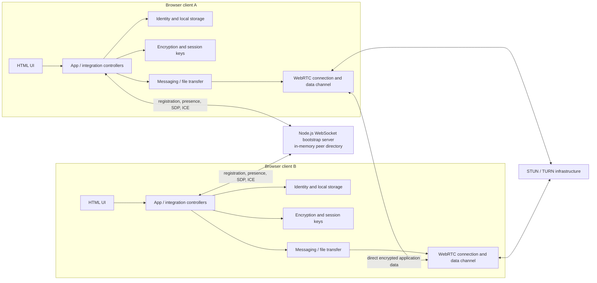

# Torrent P2P Messaging

## Software Requirements Specification

**Version:** 1.0  
**Date:** 22-Oct-2026  
**Status:** Current-system baseline; prototype  
**Prepared for:** Project team

### Revision History

| Date | Version | Description | Author |
|---|---:|---|---|
| 22-Oct-2026 | 1.0 | Initial code-derived SRS in the supplied RUP-style format. Current behavior, limitations, and planned capabilities are distinguished. | Project team |

### Table of Contents

1. [Introduction](#1-introduction)
2. [Overall Description](#2-overall-description)
3. [Specific Requirements](#3-specific-requirements)
4. [Supporting Information](#4-supporting-information)

---

## 1. Introduction

### 1.1 Purpose

This Software Requirements Specification (SRS) describes the observable behavior, interfaces, constraints, data, and quality requirements of Torrent P2P Messaging as represented by the current repository. It is intended for the project team, implementers, testers, and reviewers.

Requirements marked **Current** describe implemented or directly observable behavior. Requirements marked **Target** describe incomplete behavior that must not be treated as delivered. **Limitations** and **Open concerns** record important boundaries and mismatches discovered during repository analysis.

### 1.2 Scope

Torrent P2P Messaging is a browser-based prototype for direct peer-to-peer text messaging and file exchange. A client creates or restores a local identity, registers with a WebSocket bootstrap server, discovers online peers, and uses the server to exchange WebRTC signaling data. Once a WebRTC data channel is established, clients exchange encrypted chat messages and file-transfer data directly.

Current scope includes:

- Username-based local identity creation and restore.
- In-memory online presence and WebRTC signaling through a bootstrap server.
- Direct WebRTC peer connections and data channels.
- Client-side encryption for chat payloads and file chunks.
- Invite links, public-key fingerprints, and QR-image display.
- File chunking, integrity checks, transfer progress, and received-file download.
- Prototype heartbeat, reconnection, and content-cache components.

The system does **not** currently provide user accounts, server-side authentication, persistent chat history, offline message delivery, production-grade key protection, guaranteed file-transfer resume, or bootstrap-free discovery/signaling. The browser-compatible DHT and peer-exchange design is documented as future work, not as a delivered feature.

### 1.3 Definitions, Acronyms and Abbreviations

| Term | Definition |
|---|---|
| Peer | A running client represented by a peer ID derived from its public identity key. |
| Peer ID | A 64-character hexadecimal identifier generated by hashing a public key. |
| Bootstrap server | The WebSocket service that tracks online peers and forwards WebRTC signaling packets. |
| Signaling | Exchange of WebRTC offers, answers, and ICE candidates before a direct data channel is available. |
| ICE | Interactive Connectivity Establishment; the process WebRTC uses to find a network path between peers. |
| STUN / TURN | WebRTC services used for connection discovery and, when necessary, relaying traffic. |
| Data channel | A WebRTC channel used by clients to exchange application data directly. |
| E2EE | End-to-end encryption performed by the communicating clients rather than by the bootstrap server. |
| Invite | A shareable URL containing public peer identity and bootstrap metadata. |
| Fingerprint | A human-readable digest of a public identity key, intended for out-of-band comparison. |
| RUP | Rational Unified Process; the source format supplied for this SRS. |
| DHT | Distributed hash table; a future peer-lookup mechanism described in project planning documents. |
| Freenet prototype | Experimental content-key calculation and browser-local caching code; it is not a complete Freenet/DHT implementation. |

### 1.4 References

Repository documents and artifacts used as source material:

1. [README.md](../README.md) — product summary, setup, and deployment notes.
2. [Project.md](Project.md) — project goals, current scope, and priorities.
3. [PRD.md](PRD.md) — product goals and high-level user needs.
4. [Architecture.md](Architecture.md) — component boundaries and runtime flow.
5. [design.md](design.md) — user-interface design direction.
6. [invite-mechanism.md](invite-mechanism.md) — invite behavior and known limitations.
7. [session-restore.md](session-restore.md) — identity restore behavior and limitations.
8. [dht-peer-exchange-milestone.md](dht-peer-exchange-milestone.md) — future decentralized discovery plan.
9. [rules.md](rules.md) and [phase.md](phase.md) — development constraints and roadmap.
10. [`.env.example`](../.env.example), `client/package.json`, `server/package.json`, `server/requirements.txt`, and `tsconfig.json` — configuration and declared runtime dependencies.
11. Client and server source under `client/` and `server/`, especially `client/integration/`, `client/identity/`, `client/encryption/`, `client/messaging/`, `client/FileTransfer/`, `client/webrtc/`, `client/bootstrap/`, `client/invites/`, `client/heartbeat/`, `client/reconnection/`, and `server/bootstrap/`.
12. `C:\Users\bhumi\Downloads\SRS Document.docx` — supplied RUP-style SRS outline.

### 1.5 Technologies to be Used

The repository currently declares or uses:

- TypeScript for the client and bootstrap server.
- Browser HTML, CSS, WebSocket, WebRTC, `localStorage`, Web Crypto, and file/Blob APIs.
- Vite for client development and bundling.
- Node.js and the `ws` WebSocket package for the bootstrap service.
- `libsodium-wrappers` for identity key generation and cryptographic operations.
- ICE server configuration for STUN/TURN-assisted WebRTC connectivity.
- npm for JavaScript package management.

The client manifest declares `libsodium-wrappers` `^0.8.4`, while the HTML import map references a CDN copy of version `0.7.11`. The repository also contains `server/requirements.txt` with FastAPI/Uvicorn dependencies, but the current server entry point and implementation are TypeScript/Node.js; no Python service is identified as part of the active runtime.

### 1.6 Overview

Section 2 describes the product context, actors, use-case survey, architecture, data, constraints, and dependencies. Section 3 defines use-case reports and uniquely identified functional and supplementary requirements. Section 4 records acceptance boundaries, analysis scope, and unresolved concerns. This SRS describes a current-state prototype and does not supersede future-work documents.

## 2. Overall Description

### 2.1 Product Perspective

The product is a client/server system with two principal runtime parts:

1. A browser client that owns identity, encryption, messaging, WebRTC, file transfer, UI, and session state.
2. A lightweight WebSocket bootstrap server that keeps an in-memory peer directory and forwards signaling packets. It is not intended to relay normal chat or file payloads.

The client is organized into domain modules and integration controllers. `client/integration/App.ts` wires these modules and the browser UI. The server is organized around packet dispatch, registration and signaling handlers, peer management, and rate limiting. The current bootstrap server is a required dependency for presence and signaling.

The repository also contains a legacy `client/public/messageRouter.js` relay utility and an experimental `FreenetEngine`/cache path. Neither constitutes a functioning decentralized peer-discovery or content-delivery network in the current application.

### 2.2 Product Functions

The system's principal functions are:

- Create or restore a browser-local peer identity and register it online.
- Display peers reported by the bootstrap server.
- Negotiate direct WebRTC connections using relayed signaling packets.
- Exchange encrypted text messages over a peer data channel.
- Send files in encrypted chunks, report upload progress, verify received content, and offer a download.
- Create and verify invite links and show a public-key fingerprint.
- Display connection and application status, with partial heartbeat and reconnection support.
- Apply bootstrap-server packet validation and configured rate-limiting behavior.

### 2.3 User Classes and Characteristics

| User class | Characteristics and goals |
|---|---|
| Chat user | Enters a username, joins the bootstrap network, selects or verifies a peer, and exchanges text or files. No account or password is required. |
| Operator/developer | Configures and runs the client and bootstrap server, supplies reachable WebSocket and ICE/TURN settings, and diagnoses connection behavior. |
| Invited peer | Receives an invite link, QR code, or fingerprint out of band; verifies the public-key binding; and connects if the peer is online through the configured bootstrap service. |

### 2.4 Operating Environment

- A modern browser supporting WebSocket, WebRTC data channels, `localStorage`, cryptographic random values, and file selection/download APIs.
- A Node.js runtime and npm for the bootstrap server and client development tooling.
- A reachable WebSocket bootstrap URL for current peer registration and signaling.
- A working ICE configuration for WebRTC connectivity. Cross-network and restrictive-NAT connections may require a reachable TURN service.
- HTTPS/WSS is recommended for deployed use. No production hosting topology or availability guarantee is defined.

### 2.5 Design and Implementation Constraints

- The system is a prototype, not a production-certified messaging service.
- The bootstrap peer registry is in memory and is lost when the server process restarts.
- Identity private-key data is stored in browser `localStorage`.
- The current invite flow requires the invited peer to be online through the active bootstrap service; the invite's bootstrap URL is not automatically selected.
- WebRTC connection success depends on browser, network, and ICE/TURN configuration.
- Chat history and active WebRTC connections are not restored after a page reload.
- The server configuration declares a peer-count ceiling and message-size value, but current runtime enforcement of those values is not established by the implementation.
- No database or durable server-side store is configured.

### 2.6 Use-Case Model Survey

#### Actors

- **Chat user** — initiates login, discovery, connection, messaging, and file transfer.
- **Invited peer** — verifies an invite and attempts a connection to its owner.
- **Bootstrap server** — registers peers, returns presence, broadcasts join/leave events, forwards signaling, and reports errors.
- **ICE infrastructure** — assists peers in establishing a WebRTC path; it may include STUN and TURN services.
- **Browser** — provides the runtime, local storage, file selection/download, and WebRTC APIs.

#### Use cases

| ID | Use case | Brief description | Status |
|---|---|---|---|
| UC-01 | Join or restore session | Create/load local identity, enter a username if needed, and register with the bootstrap server. | Current, subject to reachable server. |
| UC-02 | Discover and connect to peer | Display online peers, choose one, and negotiate a WebRTC data channel. | Current, subject to network connectivity. |
| UC-03 | Verify and connect by invite | Parse an invite, verify its public-key binding, require a matching online peer, and request connection. | Current. |
| UC-04 | Exchange text message | Encrypt a message on the sender, send it directly over WebRTC, decrypt it on the receiver, and display it. | Current, subject to an established session. |
| UC-05 | Transfer file | Send file metadata and encrypted chunks, verify and assemble them at the receiver, and provide a download. | Current; up to 100 MiB per outgoing file in code. |
| UC-06 | Monitor and recover peer session | Track heartbeat/reconnection state and restore a peer session after disruption. | Partial/Target; not a complete current workflow. |
| UC-07 | Operate local system | Start the browser client and Node.js bootstrap server with reachable configuration. | Current development workflow; deployment targets are not specified. |

### 2.7 Architecture Diagram & Database Design

#### High-level architecture

The bootstrap server carries registration, peer-presence, error, and WebRTC-signaling packets. Chat and file content are intended to flow between clients over WebRTC after the data channel opens.

#### Data storage and entities

There is no relational database or server-side durable data store in the current system.

| Entity/data | Principal attributes | Current storage/lifetime |
|---|---|---|
| Local identity | Username, peer ID, public key, private key | Browser `localStorage`; persisted across reloads. |
| Peer presence record | Peer ID, username, public key, active socket | Bootstrap server memory; removed on socket close/error or server restart. |
| Invite | Version, peer ID, username, public key, fingerprint, bootstrap URL | Shareable URL/QR content; public metadata. |
| Session key | Peer-associated symmetric key | Client memory; no durable restore is specified. |
| Message | Message ID, sender/receiver IDs, type, timestamp, delivery state, encrypted payload | Client memory; conversation history is not persisted. |
| File transfer | Transfer ID, sender/receiver, filename, size, MIME type, chunk count, digest, status, encrypted chunks | In-memory transfer state while active; completed file is made available to the receiving browser. |
| Experimental content cache | Content key and cached payload/chunk | Browser `localStorage` when matching experimental inbound envelopes/chunks are processed; no retrieval, eviction, or network overlay is specified. |

### 2.8 Assumptions and Dependencies

- Both clients use compatible protocol behavior and cryptographic identity formats.
- The bootstrap server is reachable and accepts the registration/signaling exchange.
- A peer must be online in the directory for the current invite connection flow.
- A direct WebRTC path can be established using available ICE servers; TURN credentials and service availability are deployment responsibilities.
- The browser permits local storage and the required cryptographic and file APIs.
- Users exchange invite links or fingerprints through a channel they trust when they need out-of-band identity verification.
- The application does not guarantee message delivery when the destination is disconnected.
- Project roadmap items remain future work until implemented and validated.

## 3. Specific Requirements

### 3.1 Requirement Conventions

Each requirement has a unique sequential identifier. **Current** identifies behavior found in the repository. **Target** identifies an incomplete capability whose acceptance requires implementation and validation. A requirement marked **Limitation** documents a boundary rather than promising additional behavior.

### 3.2 Use-Case Reports

#### UC-01 — Join or restore session

- **Primary actor:** Chat user.
- **Preconditions:** The browser client is loaded; a bootstrap server URL is available.
- **Trigger:** The user selects Login, or the client finds a stored identity at startup.
- **Main flow:**
  1. The client validates that a new username is non-empty.
  2. The client loads a matching stored identity or creates a new key pair and peer ID.
  3. The client stores identity data and username in browser storage.
  4. The client opens a WebSocket to the bootstrap server and registers the peer ID, username, and public key.
  5. The server returns the current peer list; the client displays online peers.
- **Alternate/error flows:** Missing username, invalid stored identity, or bootstrap connection failure is reported to the user. A server error may reject registration.
- **Postcondition:** The client has local identity state and, when registration succeeds, an online presence record.
- **Related requirements:** REQ-001 through REQ-004, REQ-019.

#### UC-02 — Discover and connect to peer

- **Primary actor:** Chat user.
- **Preconditions:** The user is registered; the target peer appears in the online list.
- **Trigger:** The user selects an online peer and chooses Connect.
- **Main flow:**
  1. The client creates a peer connection and prepares peer session-key material.
  2. The initiating client creates a WebRTC offer and sends it through the bootstrap server.
  3. The receiving client applies the offer, creates an answer, and sends it through the server.
  4. Both clients exchange ICE candidates through the server.
  5. The clients establish a direct WebRTC data channel and show connection state.
- **Alternate/error flows:** An unavailable target, invalid signaling data, rejected server request, or ICE/network failure prevents connection and is surfaced through status/error handling where available.
- **Postcondition:** A direct data channel is available when negotiation succeeds.
- **Related requirements:** REQ-005 through REQ-008, REQ-024.

#### UC-03 — Verify and connect by invite

- **Primary actor:** Invited peer.
- **Preconditions:** The invite link or encoded invite is available; the invited peer is online in the configured bootstrap directory.
- **Trigger:** The user pastes or opens an invite and chooses Verify/Connect.
- **Main flow:**
  1. The client decodes the invite and reads its public identity fields.
  2. The client derives the peer ID and fingerprint from the included public key.
  3. The client reports whether those values match the invite.
  4. Before connection, the client requires an online peer with the same peer ID and public key.
  5. The client begins WebRTC signaling to that peer.
- **Alternate/error flows:** Invalid encoding, mismatched peer ID/fingerprint, offline peer, or online-key mismatch blocks the connection and displays an error.
- **Postcondition:** A verified invite can initiate connection only when a matching peer is online.
- **Related requirements:** REQ-009 through REQ-011, REQ-025.

#### UC-04 — Exchange text message

- **Primary actors:** Sending and receiving chat users.
- **Preconditions:** Both users have an open WebRTC data channel and compatible peer session keys.
- **Trigger:** The sender enters non-empty text and selects Send.
- **Main flow:**
  1. The sender encrypts the text and serializes message metadata and payload.
  2. The sender sends the message over the peer data channel.
  3. The receiver validates the message structure and sender identity, decrypts the payload, and displays the text.
  4. The clients keep the current conversation in memory for the active page session.
- **Alternate/error flows:** Empty text, missing channel/session key, invalid message, sender mismatch, or decryption failure prevents successful display and is reported through the available error path.
- **Postcondition:** A successfully received message is visible to the receiver; durable storage and offline delivery are not provided.
- **Related requirements:** REQ-012 through REQ-015, REQ-021.

#### UC-05 — Transfer file

- **Primary actors:** Sending and receiving chat users.
- **Preconditions:** Both users have an open peer data channel and compatible session keys.
- **Trigger:** The sender chooses a file and selects Send File.
- **Main flow:**
  1. The sender rejects an empty file or a file larger than 100 MiB.
  2. The sender calculates transfer metadata and divides the file into chunks.
  3. The sender encrypts each chunk and sends metadata and chunks directly over WebRTC.
  4. The receiver validates transfer/chunk structure, decrypts and assembles chunks, and checks content integrity.
  5. The client reports upload progress and offers a completed received file for download.
- **Alternate/error flows:** Invalid metadata, unknown transfer, sender mismatch, invalid chunk, interrupted connection, decryption failure, or failed integrity check prevents successful completion.
- **Postcondition:** A completed and verified file is available to the receiving user. Resume after interruption is not specified as a current capability.
- **Related requirements:** REQ-016 through REQ-018, REQ-021.

#### UC-06 — Monitor and recover a peer session

- **Primary actor:** Chat user.
- **Preconditions:** A peer session exists or has been interrupted.
- **Expected flow:** The client reports liveness, detects loss, retries according to a bounded policy, and restores the WebRTC/session state when possible.
- **Current status:** Heartbeat and reconnection modules exist, but the normal connection path marks heartbeat as disabled and the reconnect path is not demonstrated as a complete signaling-and-data-channel restoration flow. Reload restores identity/bootstrap registration only; active peer connections and chat are not restored.
- **Related requirements:** REQ-022 through REQ-024.

#### UC-07 — Operate the local system

- **Primary actor:** Operator/developer.
- **Preconditions:** Node.js/npm and a compatible browser are installed.
- **Main flow:** The operator starts the Vite client and the Node.js bootstrap server, then configures a reachable bootstrap URL and ICE services as needed.
- **Alternate/error flows:** Missing dependencies, invalid configuration, unreachable bootstrap service, or unavailable TURN service prevents some or all connection workflows.
- **Postcondition:** The client can be used for prototype validation when both client and server are reachable.
- **Related requirements:** REQ-026 through REQ-030.

### 3.3 Supplementary Requirements

#### 3.3.1 Functional Requirements

- **REQ-001 — Current:** The client shall accept a non-empty username before creating a new local identity.
- **REQ-002 — Current:** The client shall create or load an identity key pair, public identity, username, and peer ID. A peer ID shall be derived from the public key.
- **REQ-003 — Current:** The client shall persist identity information and the last username in browser storage and attempt to restore a valid identity on page startup.
- **REQ-004 — Current:** The client shall connect to the configured bootstrap WebSocket service and register the local peer ID, username, and public key.
- **REQ-005 — Current:** The bootstrap service shall keep active peer records in memory, return the current peer list after registration, and broadcast peer-join and peer-leave notifications.
- **REQ-006 — Current:** The client and bootstrap service shall exchange WebRTC offer, answer, and ICE-candidate signaling packets addressed to a target peer.
- **REQ-007 — Current:** The client shall establish a WebRTC data channel with a selected peer when signaling and network conditions allow.
- **REQ-008 — Current:** The client shall show online and connected peers and shall provide a user action to request connection or disconnection.
- **REQ-009 — Current:** The client shall create an invite containing the public peer identity, username, fingerprint, version, and bootstrap URL, and shall expose a shareable link and QR image.
- **REQ-010 — Current:** The client shall validate an invite by deriving the peer ID and fingerprint from its included public key.
- **REQ-011 — Current:** Before connecting from an invite, the client shall require the invited peer to be online and its advertised public key to match the verified invite.
- **REQ-012 — Current:** The client shall derive peer session-key material from the local private identity and remote public key, then use the encryption module to protect message and file payloads.
- **REQ-013 — Current:** The receiving client shall reject malformed message payloads, sender-identity mismatches, or payloads it cannot decrypt rather than displaying them as valid plaintext.
- **REQ-014 — Current:** A user shall be able to send non-empty text to a connected peer with an open data channel.
- **REQ-015 — Current:** The client shall display successfully received text and keep current conversation state in memory. It shall not represent that history as durable across a page reload.
- **REQ-016 — Current:** A user shall be able to send a non-empty file no larger than 100 MiB to a connected peer. The default outgoing chunk size shall be 64 KiB.
- **REQ-017 — Current:** The client shall encrypt file chunks, associate them with transfer metadata, validate sender/chunk structure, assemble received chunks, and verify the completed payload before reporting successful receipt.
- **REQ-018 — Current:** The client shall report outgoing file-transfer progress and make a successfully received file available for browser download.
- **REQ-019 — Current:** The bootstrap service shall validate packet envelopes and registration/signaling payload shapes and shall send an error packet for invalid or unsupported requests when possible.
- **REQ-020 — Current:** The bootstrap service shall apply its configured in-memory rate limiter to inbound packet processing. In the current implementation all packet types are assigned to the public scope.
- **REQ-021 — Current, limited:** When an incoming chat envelope or file chunk matches the experimental content-cache format, the client may calculate a key and store the received data in browser storage. This behavior does not provide peer routing, content lookup, eviction, or a complete DHT.
- **REQ-022 — Target:** The client should start heartbeat monitoring for an established peer session, update the visible peer liveness state, and mark a peer unresponsive after its configured timeout.
- **REQ-023 — Target:** On peer connection loss, the client should perform bounded retries and re-establish signaling, data-channel, and session-key state before reporting the peer as reconnected.
- **REQ-024 — Current, limited:** On page reload, the client shall attempt to restore its local identity and bootstrap registration. It shall not claim to restore active WebRTC channels or conversation history.
- **REQ-025 — Limitation:** The invite's bootstrap URL is currently informational; accepting an invite does not automatically change the runtime bootstrap endpoint.

#### 3.3.2 Quality and Supplementary Requirements

- **REQ-026 — Maintainability, Current:** Client responsibilities shall remain separated into identity, bootstrap, discovery, WebRTC, encryption, messaging, file transfer, heartbeat, reconnection, invite, and integration modules.
- **REQ-027 — Security, Current with limitations:** The bootstrap server shall be used for presence and signaling rather than normal chat/file payload delivery. Client encryption shall fail the affected operation when a session key is missing or decryption fails.
- **REQ-028 — Security limitation:** The system shall not claim hardened private-key storage. The current browser identity store contains private-key material in `localStorage`, accessible to scripts running in the same origin.
- **REQ-029 — Privacy limitation:** Online username, peer ID, and public key are disclosed to the bootstrap service and other clients in peer-list events. Invite QR rendering uses a public image service and can disclose invite-link metadata to that service.
- **REQ-030 — Resilience, Current with limitations:** Invalid packets, unavailable peers, and connection/crypto failures shall be surfaced through available error, status, or log paths. Recovery and delivery are not guaranteed.
- **REQ-031 — Availability, Current:** Peer discovery and signaling depend on the bootstrap service. There is no offline message queue or guaranteed delivery mechanism.
- **REQ-032 — Compatibility, Current:** The client shall depend on browser WebSocket, WebRTC, cryptographic, storage, and file APIs. Actual network reachability is conditional on browser and ICE/TURN support.
- **REQ-033 — Capacity, Current/configuration gap:** The server declares limits of 1,000 peers, 64 KiB WebSocket messages, and 32-character usernames. The username limit is checked at registration; enforcement of the declared peer-count and message-size limits is not established in the current server runtime.
- **REQ-034 — Performance, Open:** No supported concurrent-user target, message latency target, file throughput target, or availability objective is specified. These values must be agreed and measured before production use.
- **REQ-035 — Data, Current:** The server shall not be treated as a persistent database. Server peer records are volatile; local identity is stored by the browser; message/conversation state is in memory; and file-transfer state is temporary.
- **REQ-036 — User interface, Current:** The browser client shall provide controls for login, peer selection, invite verification, chat, file selection, transfer progress, and visible status/log feedback. The interface is responsive for narrow viewports, but no accessibility conformance level is specified.

#### 3.3.3 External Interface Requirements

**User interface**

- The client shall provide a username/login control, online-peer list, connect/disconnect actions, invite and fingerprint controls, chat area, file chooser, progress display, status indicators, and application log.
- User-visible failures shall be shown through the relevant error message, status field, alert, or application log when that workflow has a wired error path.
- The client shall provide a download link for a successfully received file.

**Bootstrap client/server interface**

- The client and server shall exchange JSON envelopes over WebSocket.
- Current packet categories are registration, peer list, peer joined, peer left, offer, answer, ICE candidate, and error.
- Registration data includes peer ID, username, and public key. Signaling includes sender, target, and offer/answer/candidate payload.
- The current server maintains presence in memory and forwards signaling to a connected target.

**Peer interface**

- After negotiation, clients shall exchange chat, file-transfer, and application-level heartbeat data over WebRTC data channels.
- ICE server lists and transport policy may be supplied through supported runtime configuration.
- A failed direct path may require a TURN relay; availability of a public or private relay is not guaranteed by the application.

**Invite interface**

- The invite shall be transferable as a URL or QR image.
- Invite verification shall be based on the public-key-to-peer-ID and fingerprint relationship, followed by comparison with the online peer record.
- The displayed fingerprint can be compared manually out of band; the application does not provide a dedicated safety-number ceremony.

### 3.4 Data Requirements

The system shall handle the following data categories:

1. **Identity data:** Username, peer ID, public key, and private key. Private-key data remains client-side but is currently persisted unencrypted in browser storage.
2. **Presence data:** Peer ID, username, public key, and active WebSocket association. Presence is volatile and server-managed.
3. **Message data:** Message ID, sender/receiver IDs, message type, timestamp, delivery status, and encrypted payload. The app keeps conversation state in memory only.
4. **File data:** Transfer ID, file name, MIME type, size, chunk count, digest, encrypted chunk payloads, and status. The application uses a 100 MiB outgoing limit and 64 KiB default chunk size.
5. **Invite data:** Version, public peer identity, username, fingerprint, and bootstrap URL. Invites must not contain private keys or session keys.
6. **Experimental cache data:** Content keys and incoming data stored in browser storage by the partial Freenet-oriented cache path. Retention, deletion, quota management, and retrieval are not specified.

### 3.5 Error Handling Requirements

- **ERR-001:** Invalid bootstrap envelopes and registration/signaling payloads shall be rejected with an error response when the connection permits.
- **ERR-002:** The client shall surface missing username, bootstrap connection errors, invalid invites, key mismatches, unavailable peers, and failed message/file operations through the relevant UI path.
- **ERR-003:** Invalid message decryption, file chunk validation, or completed-file integrity verification shall not be reported as successful receipt.
- **ERR-004:** Diagnostic output should not expose private keys, session keys, or plaintext message/file contents. The current project should be reviewed before production use because some debug logging includes peer/payload data.

## 4. Supporting Information

### 4.1 Acceptance and Validation Boundaries

The following checks define a prototype-level acceptance baseline:

1. A user can enter a valid username and register with a reachable bootstrap server.
2. Two registered clients can discover each other and exchange WebRTC signaling.
3. When browser/network/ICE conditions permit, a direct data channel opens.
4. The clients can exchange a text message and transfer a file within the outgoing size limit; the receiver only reports a file as complete after integrity validation.
5. Invite verification rejects a changed public key, peer ID, or fingerprint and refuses to connect when the online peer key differs.
6. A page reload restores the local identity and attempts bootstrap registration, without claiming to preserve active peer connections or conversation history.
7. Invalid registration/signaling packets produce an error response where possible and do not terminate the server process.

These are behavior checks, not performance, production-security, uptime, or cross-network guarantees. Cross-network tests require a reachable deployment and suitable ICE/TURN configuration. The repository currently includes manual server scripts (`server/test-register.js` and `server/test-join.js`); no unified automated test command is declared in the client or server package scripts.

### 4.2 Repository Analysis Scope

The analysis covered the 145 tracked first-party project files, including the 114 authored client/server source files (91 under `client/` and 23 under `server/`), project documentation, package/configuration files, UI assets, and manual server probes. Vendored `node_modules`, generated build output, runtime logs, and the local Python virtual environment were excluded from product behavior requirements. Legacy and experimental source was considered separately from the active documented workflows.

### 4.3 Concerns / Queries / Doubts if any

1. **Browser entry point:** `client/index.html` references `./app.js`, while the repository source entry is `client/app.ts` and no `client/app.js` exists at the client root. Reconcile and validate the actual development/build entry point before using UI acceptance results.
2. **Bootstrap configuration:** README examples use `VITE_BOOTSTRAP_URL`, but `client/bootstrap/bootstrapConfig.ts` currently reads the `server` query parameter or `window.env.VITE_BOOTSTRAP_SERVER_URL`, then prompts and falls back to `ws://localhost:8080`. Align implementation and documentation.
3. **Cryptography package source:** The package manifest and HTML import map specify different `libsodium-wrappers` versions. Define one supported runtime source/version.
4. **File integrity algorithm:** File-transfer fields and method names identify the digest as SHA-256, while the implementation uses `libsodium` generic hashing. Confirm the intended digest algorithm and update the code/labels or protocol contract accordingly.
5. **Server limits:** The peer-count and WebSocket message-size values are declared in server configuration, but enforcement is not evident in server construction/registration. Confirm intended limits and enforce or remove them.
6. **Rate-limit configuration:** The rate limiter exposes auth/public/authenticated scopes, but the server currently assigns all packet types to the public scope. Confirm whether the other configured scopes are intended to be active.
7. **Heartbeat/reconnection:** Heartbeat is shown as disabled on peer connection, and reconnection restoration is not demonstrated as a full signaling exchange. Decide whether these remain experimental or should be completed before claiming resilience.
8. **Freenet/DHT scope:** The current content-key and local-cache code does not implement peer exchange, content retrieval, durable cache management, or DHT routing. Treat decentralized discovery/content delivery as future work unless completed and tested.
9. **QR privacy:** The QR image URL is generated by a third-party service. Decide whether external disclosure of invite metadata is acceptable or replace it with local QR generation.
10. **Production targets:** Define measurable concurrency, responsiveness, availability, data retention, browser support, and security assurance targets before production deployment.

### 4.4 Appendices and Requirement Status

- This SRS is a repository-derived baseline; implementation verification is still required for deployment-specific behavior.
- **Current** does not imply production readiness or independent security validation.
- **Target** items are not acceptance commitments until implemented and tested.
- Planned DHT, peer exchange, signed peer records, peer-connection restoration, persistent chat, and production-grade key management remain outside current delivered scope.
